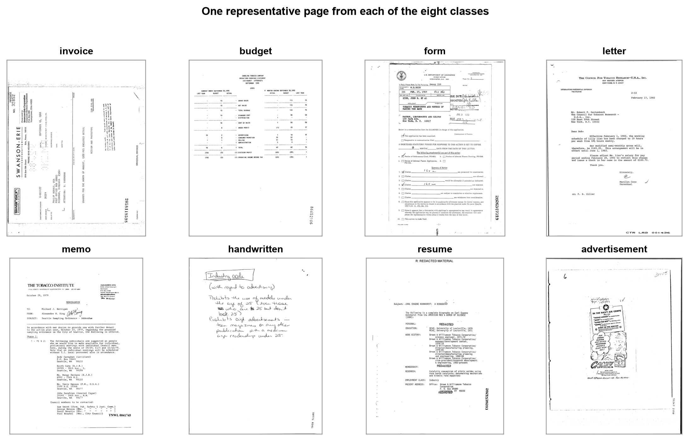
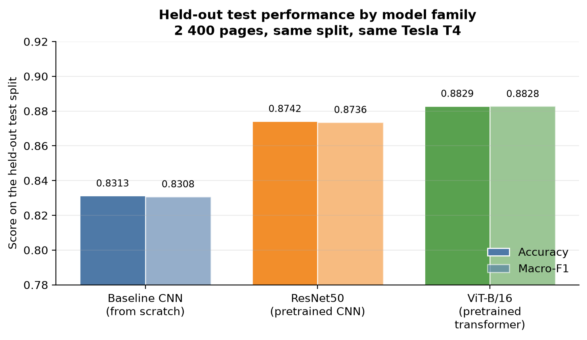
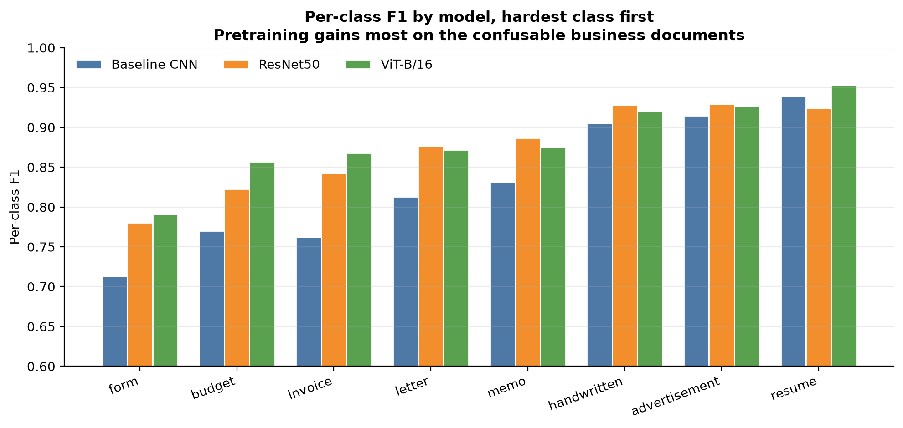
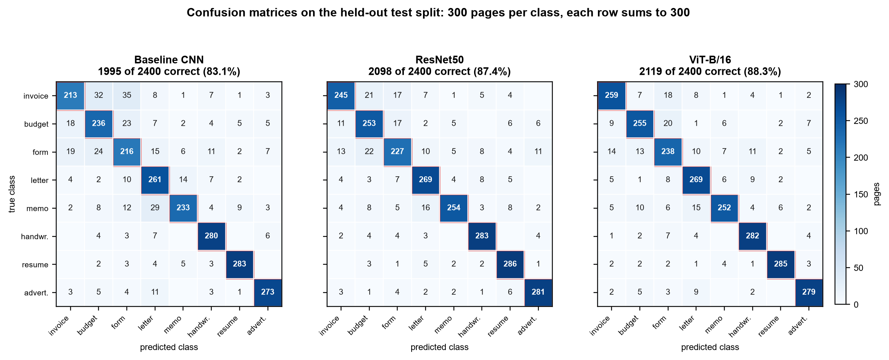
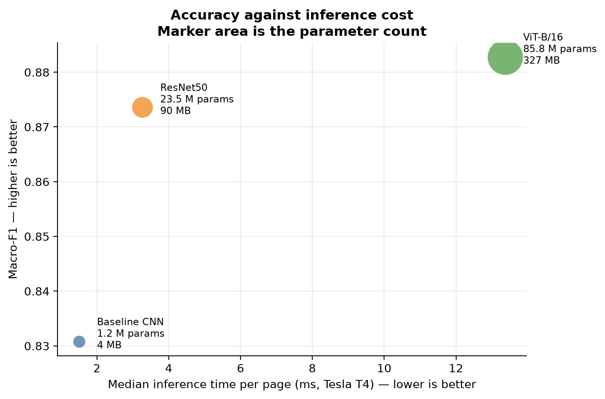
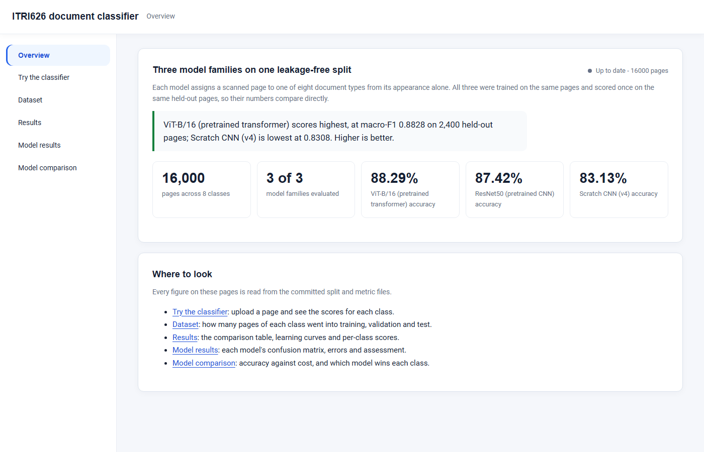
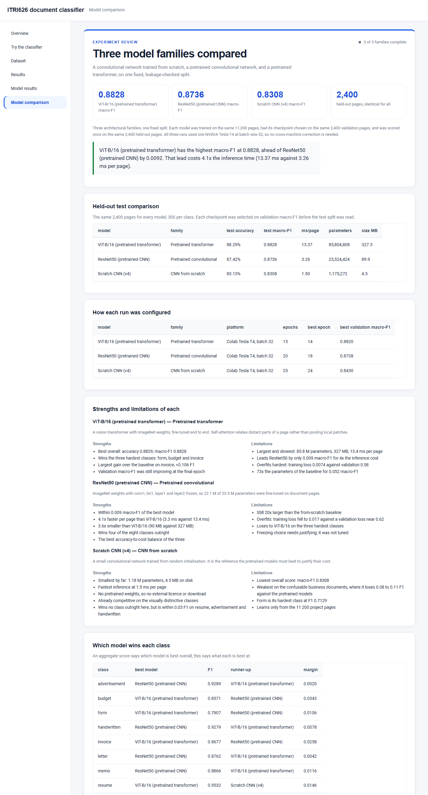

# Document image classification for client onboarding

**ITRI626 practical project** · North-West University · 2026
**Group 2:** R. Hlumbene (42452422) and C. Sibanda (56543115)
**Title:** Comparative deep learning models for the automated classification of client onboarding document images

A scanned or photographed page is assigned to one of eight document types from
its visual appearance alone, with no text recognition, so an intake queue can
route the page automatically or flag it for human review. Three models from
three architectural families are compared on one fixed, leakage-free split:

| Model | Family | Held-out accuracy | Macro-F1 | ms per page | Parameters | Size |
|-------|--------|------------------:|---------:|------------:|-----------:|-----:|
| ViT-B/16 | Pretrained transformer | **88.29%** | **0.8828** | 13.37 | 85.8 M | 327 MB |
| ResNet50 | Pretrained convolutional | 87.42% | 0.8736 | 3.26 | 23.5 M | 90 MB |
| Baseline CNN | Trained from scratch | 83.13% | 0.8308 | **1.50** | **1.2 M** | **4.5 MB** |

All three were trained on the same 11 200 pages, had their checkpoint chosen on
the same 2 400 validation pages, and were scored once on the same 2 400
held-out pages (300 per class), on one NVIDIA Tesla T4 at batch size 32.

**The finding.** ViT-B/16 is the most accurate, but only by 0.009 macro-F1
over ResNet50, at four times the inference time and 3.6 times the size.
ResNet50 is the best balance of accuracy and cost. Pretraining is worth about
0.05 macro-F1 over the from-scratch baseline, and almost all of that gain is on
the confusable business documents: invoice, budget and form.

The claim this repository is built to defend is not "a model reached X
percent". It is that the number means what it says: the split is grouped by
source document so no page can leak between training and test, the overlap
check runs before every evaluation, and the metrics are unit-tested against
hand-worked values.

## The eight classes



Invoice and budget are a deliberate near-neighbour pair; letter and memo are
the second. Advertisement stands in for the irrelevant upload that a real
intake queue must reject. The pages are from RVL-CDIP; see
[Dataset](#dataset) for the source and licence.

## Results



### Where each model wins

The aggregate score hides where the models differ. ViT-B/16 wins form, budget,
invoice and resume; ResNet50 wins advertisement, handwritten, letter and memo.
The from-scratch baseline is within about 0.03 F1 of both on resume,
advertisement and handwritten, and loses 0.08 to 0.11 F1 on the business
documents.



### What the models confuse

Most errors fall between invoice, budget and form, the three business documents
with tabular layouts, and between letter and memo.



### Accuracy against cost



The full tables are in [`outputs/comparison/`](outputs/comparison/): the
comparison, per-class scores for every model, the winner of each class, every
epoch's history and every misclassified page. Each model's own confusion
matrices, learning curves and error examples are in `runs/<model>/figures/`.

## Dashboard

A local web dashboard shows the dataset, the comparison and each model's
results, and classifies an uploaded page live.

```bash
python ui/server.py      # then open http://127.0.0.1:8626
```





The results pages need only the Python standard library. The live classifier
needs the project environment and one trained checkpoint, `<model>_best.pt`,
copied into `runs/<model>/checkpoints/`; it serves the most accurate model
whose weights are present.

## Repository layout

| Path | Contents |
|------|----------|
| `src/docclf/` | The library: config, data, splits, models, training, evaluation. Each module has its own README |
| `run_*.py` | The entry points: prepare, split, train, evaluate, compare, status, check |
| `configs/` | One YAML per model, plus one per machine for paths, batch size and device |
| `data/splits/` | The committed split files every result was measured on. The images themselves are not committed |
| `runs/<model>/` | Each model's metrics, figures and logs |
| `outputs/` | The cross-model comparison and the report figures |
| `notebooks/` | The submitted notebooks, from dataset cleaning to the final comparison |
| `tests/` | 122 unit tests, including the leakage and metric suites |
| `ui/` | The results dashboard and live classifier |
| `docs/` | Dataset card, experiment log, and how-to guides for Colab and multi-machine training |
| `report/`, `slides/` | Where the report's and the presentation's evidence lives |

## Quick start

On Windows, create the environment outside the repository. The repository path
is deep enough that some of PyTorch's file names exceed the Windows path limit
inside a repository-local `.venv`.

```bash
python -m venv %USERPROFILE%\venvs\itri626
%USERPROFILE%\venvs\itri626\Scripts\activate

pip install torch==2.13.0 torchvision==0.28.0 --index-url https://download.pytorch.org/whl/cpu
pip install -r requirements.txt

pytest tests/ -q          # 122 tests; no dataset and no network needed
```

`setup_requirements.bat` and `setup_requirements.sh` do the same in one step.

The smoke configuration runs the whole pipeline on a 200-page-per-class sample
in a few minutes on a laptop CPU:

```bash
python extract_rvl_cdip.py --source <rvl-cdip folder> --per-class 200 --dest data/interim/smoke_raw
python run_prepare_data.py --config configs/smoke.yaml
python run_split.py        --config configs/smoke.yaml
python run_train.py        --config configs/smoke.yaml --model baseline_cnn
python run_evaluate.py     --config configs/smoke.yaml --model baseline_cnn
```

## Reproducing the results

```bash
python run_check.py                 # is this machine ready: environment, data, splits
python run_status.py                # which models are complete, running or not started
./train_model.sh resnet50           # train, resume if interrupted, then evaluate
python run_compare.py               # rebuild every cross-model table and figure
```

`train_model.sh` takes `baseline_cnn_v4`, `resnet50` or `vit_b16`. A checkpoint
is written every epoch with the optimiser, scheduler and early-stopping state,
so an interrupted run resumes where it stopped. Training on a Colab GPU is
described in [`docs/colab.md`](docs/colab.md), and training different models on
several machines at once in [`docs/multi-machine.md`](docs/multi-machine.md).

**Do not regenerate `data/splits/`.** Every recorded result was measured on the
committed split, and replacing it makes the numbers incomparable. Image paths
in those files are relative to the project root, so the same split works on
every machine.

## Dataset

RVL-CDIP (Harley, Ufkes and Derpanis, 2015), eight of its sixteen classes,
capped at 2 000 pages per class: 16 000 pages, split 11 200 / 2 400 / 2 400,
grouped by source document. The images come from the Legacy Tobacco Document
Library and are used under US fair use for teaching and research; they are not
redistributed here. The source, licence, cleaning counts and download
instructions are in [`docs/dataset-card.md`](docs/dataset-card.md).

## Reproducibility

Every result is reproducible from three things: the config file, the pinned
`requirements.txt`, and the commit hash, all of which each run records in its
log. One global seed (626) drives every source of randomness, and the split
files are committed so that a reader recreates the exact experiment rather than
a similar one. The hardware and library versions behind every run are recorded
in [`docs/experiment-log.md`](docs/experiment-log.md).
